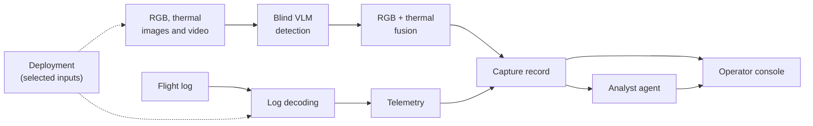

# Plotter: Multispectral Person Detection with Flight-Telemetry Fusion for UAV Search and Rescue

## Abstract

Search-and-rescue (SAR) operators need to find people quickly in aerial imagery, and to know where the aircraft was when each finding was made. *Plotter* is a research prototype that brings together flight-log telemetry, visible-light and thermal imagery, and a general-purpose vision-language model (VLM) used without task-specific training. It detects people in each imaging modality, combines the results, ties every finding to the drone's state at the time, and has a language-model *analyst agent* turn each finding, and the mission as a whole, into a short operator-facing conclusion. An operator console presents the mission at a glance. This document describes the problem, the system and its parts, the data it works with, and the limits of the approach.

---

## 1. Introduction

Small UAVs often carry both a visible-light (RGB) and a thermal camera. The two modalities fail differently: RGB degrades at night, in haze and under glare, while thermal loses texture and can mistake warm objects for people. A system that looks in both and reasons about whether they agree should be more trustworthy than either alone, and a detection is only actionable when it is tied to a position.

The project asks three questions:

- **RQ1.** How well can an off-the-shelf VLM, given no labels and no fine-tuning, find and describe small people in aerial RGB and thermal imagery?
- **RQ2.** Can agreement between independent RGB and thermal detections serve as a useful confidence signal?
- **RQ3.** Can detections, telemetry and a language-model agent be combined so an operator receives a concise, grounded conclusion for each finding and for the mission?

## 2. Related work and resources

- **KAIST Multispectral Pedestrian Benchmark** (Hwang et al., CVPR 2015): aligned RGB and thermal image pairs with pedestrian annotations.
- **SARD, Search And Rescue Dataset** (CC BY 4.0): drone-view RGB imagery annotated with posture classes.
- **Thermal Image Dataset**: thermal imagery annotated for person detection.
- **ArduPilot DataFlash logs**: the flight-log format used for telemetry.
- **Ollama**: serves the vision-language model.

## 3. System overview

| Component | What it is | What it does |
|-----------|------------|--------------|
| Log decoding | Converter for flight logs | Turns a recorded flight log into per-sensor tables for analysis and plotting |
| Detection | A vision-language model used zero-shot | Finds people in an image and describes and classifies them, without ever seeing dataset labels |
| Fusion | A combiner for an RGB/thermal pair | Matches the people found in each modality and marks which were seen by both sensors |
| Capture record | A structured summary of one finding | Bundles the detections with the drone's state at that moment |
| Analyst agent | A language-model assistant | Reads a capture record, or a whole mission, and writes a plain-language conclusion |
| Deployments | Named bundles of inputs | Let the whole system switch between sets of datasets and inputs |
| Operator console | A web interface | Shows imagery, detections, the flight map, alerts and conclusions |

## 4. Datasets

Three public datasets are used.

| Dataset | Content | Role |
|---------|---------|------|
| SARD | Drone-view RGB with annotations for several postures (running, walking, laying down, seated, standing, undefined) | Small-target detection and posture classification |
| Thermal set | Thermal frames with person annotations | Thermal-only detection |
| KAIST (preview) | Aligned RGB and thermal pairs with pedestrian annotations | RGB/thermal fusion |

Each dataset has a different viewpoint, target size and annotation scheme. Targets in the drone-view data are small relative to the frame, which is the hardest regime for general-purpose models, while the paired set offers larger targets from a ground vehicle. Annotations are used only to show ground truth alongside a detection and for evaluation, never to guide the model. Dataset visualisations are produced in the accompanying notebook.

## 5. Method

### 5.1 Flight-log decoding and telemetry

A recorded flight log is decoded into one table per message type (attitude, battery, GPS, inertial sensors and others). These tables supply the drone state attached to each finding: position, altitude, speed, heading, attitude, battery, GPS quality and flight mode. Plots of the main signals are described in [`docs/graphs.md`](docs/graphs.md) and the meaning of the features in [`docs/understanding-the-data.md`](docs/understanding-the-data.md).

Imagery and flight data are not recorded together, so the telemetry is replayed against the imagery sequence. This exercises the data path and makes no claim about real geolocation accuracy.

### 5.2 Blind zero-shot detection

A frame is given to the VLM together with a task description (it acts as the vision system of a SAR drone) and a list of the posture classes it may use. The model is never given dataset labels, positions or counts. For each person it reports a class, a short description and a bounding box.

### 5.3 RGB-thermal fusion and confidence

The RGB and thermal frames of a pair are examined independently. Detections that overlap in both are combined into a single *confirmed* person; detections seen by only one sensor are kept and marked as single-sensor. Confidence is an ordinal indication of agreement, not a calibrated probability.

### 5.4 Capture record

Each finding produces a structured record: the frame, the drone's telemetry, per-sensor counts and the fused detections with their sources and confidence. This record is the unit that downstream components read.

### 5.5 Analyst agent

The agent reads a capture record and writes a short assessment, a location expressed relative to the drone's view, and a recommended action, with an instruction not to state anything the record does not support. A second mode summarises a whole mission (situation, priority targets, gaps and next actions). The agent is advisory only.

### 5.6 Deployments

A deployment is a named bundle of the inputs the system works on. Switching deployment changes what every part of the console shows. See [`docs/deployments.md`](docs/deployments.md).

### 5.7 Operator console

A single screen presents system status, a flight map with the location of each finding, flight vitals, rule-based alerts, a log of findings and a mission brief. A sweep mode runs detection across a sequence of frames to simulate a search pass. See [`docs/control-centre.md`](docs/control-centre.md).

## 6. Limitations and threats to validity

- **No formal evaluation yet.** Quantitative measures such as precision, recall and average precision against ground truth are future work.
- **Non-determinism.** Language models can return different answers on repeated calls; single runs are not guaranteed to be reproducible.
- **Posture classification is difficult**, particularly for very small people, so alerts based on posture are a prompt for human review, not a diagnosis.
- **Small objects.** People in drone-view imagery occupy a tiny fraction of the frame, which strains the effective resolution of general-purpose models.
- **Simulated telemetry.** Imagery and flight data are not co-recorded, so positions and vehicle state illustrate the data path rather than real geolocation.
- **Heuristic fusion.** Combining detections assumes the sensors are aligned, and the confidence levels are ordinal rather than calibrated.
- **Agent grounding.** The agent is instructed not to invent facts, but its conclusions are not verified automatically and can inherit detector errors.
- **Dataset scope.** The conclusions that can be drawn are limited by the conditions each dataset covers.

## 7. Future work

The planned move from offline analysis to a live, simulated one-drone mission is described in [`docs/scope.md`](docs/scope.md). Further directions include:

1. Quantitative evaluation per modality and for fused output, with repeated runs.
2. Multi-scale inference for small targets, and comparison with a conventional trained detector.
3. Calibrated confidence from agreement statistics.
4. Real co-recorded imagery and telemetry, enabling geo-referenced detections.
5. Temporal tracking across frames.
6. A human-in-the-loop study with SAR operators.

## References

1. S. Hwang, J. Park, N. Kim, Y. Choi, I. S. Kweon. *Multispectral Pedestrian Detection: Benchmark Dataset and Baseline.* CVPR 2015. https://github.com/SoonminHwang/rgbt-ped-detection
2. SARD: Search and Rescue Dataset (Roboflow, CC BY 4.0). https://www.kaggle.com/datasets/nikolasgegenava/sard-search-and-rescue
3. Thermal Image Dataset. https://www.kaggle.com/datasets/animeshmahajan/thermal-image-dataset
4. ArduPilot DataFlash log format. https://ardupilot.org

_Property of Harshith Ashok_
