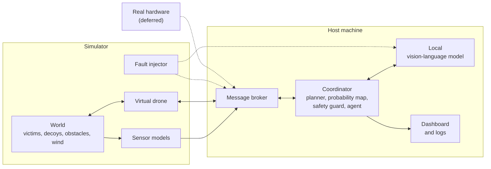

# Scope: a one-drone, simulated search-and-rescue mission

[`Abstract.pdf`](Abstract.pdf) describes a thesis, *Simulation of an Autonomous Search-and-Rescue Quadcopter*: a drone, a mission coordinator, a simulated world, a deterministic planner with a code-based safety guard, and a language-model agent that advises but never flies. This document states the scope of the work and the claims it aims to support, and describes at a high level the capabilities the system needs.

## 1. Scope decisions

1. **One drone.** A single drone and a single coordinator. Multi-drone coordination is future work.
2. **No hardware integration.** Physical flight hardware (onboard computer firmware, real inertial sensors, real cameras, a real flight controller) is out of scope. The drone is a **software simulation** that exchanges the same messages real hardware would, so hardware can replace it later without changing the rest of the system.
3. **One host machine.** The coordinator, message broker, safety guard, agent, operator dashboard and the language-model server all run on the same machine.
4. **Local inference.** A **local vision-language model** provides all model inference. Nothing needs the internet at run time.

The host must therefore have enough memory and compute to run a vision-language model alongside everything else. Small single-board computers with about 1 GB of memory are not suitable. The sizing guidance in this document is a planning estimate and has not been measured on the final hardware.

## 2. The system

The drone and the coordinator communicate only through messages, so the message interface is the point where real hardware could later be attached.

The work is organised in loops running at different speeds, with the language model confined to the slowest:

| Loop | Responsibility |
|------|----------------|
| Control | Moves the drone and handles failsafes |
| Navigation and telemetry | Follows waypoints and reports state |
| Mission reasoning | Chooses where to search next, reviews ambiguous detections and writes reports; event-driven |

Principles the design follows:

- the language model outputs high-level intent only, and deterministic code turns intent into waypoints;
- every plan passes a safety guard written as ordinary code, which can veto it;
- the agent reacts to events rather than running continuously;
- if the model is unavailable, slow or invalid, the deterministic search continues.

## 3. What the system does

| Capability | Purpose |
|------------|---------|
| Message interface | A fixed, versioned contract for state, detections, commands and heartbeats between all parts |
| Live telemetry | Position and vehicle state in a local metric frame measured from a home point |
| Deterministic coordinator | Plans coverage of the search area, maintains a map of where a victim is likely to be, replans around obstacles and keeps the drone within safe limits; this is the baseline everything else is compared with |
| Detection handling | Notices candidate victims, confirms them, reports them with a confidence and waits for operator approval |
| Perception | Finds candidate people from thermal data with simple deterministic rules and uses the model only to review ambiguous candidates |
| Safety guard | Checks every proposed plan and command against geographic, altitude, battery and link-loss rules |
| Agent | Reasons about detections and search priorities within a constrained, validated interface, with human approval for high-impact actions |
| Simulator | Provides a repeatable world with hidden victims, decoys, obstacles, wind, simulated sensors and injectable faults |
| Logging and evaluation | Records every message and decision so any run can be replayed and compared fairly |
| Dashboard | Shows the map, path, coverage, probability map, detections, pending approvals and system health |

### Simulator

The simulator is made of independent parts that communicate only through messages and a shared scenario description:

- **World:** ground truth, including hidden victims, decoys, obstacles, no-fly zones, wind and a simulation clock.
- **Virtual drone:** the drone's behaviour as a state machine with simple motion and battery models, including its reaction to losing contact.
- **Sensor models:** readings generated from the world and the drone's pose, including simulated thermal imagery and visible-light frames drawn from public datasets.
- **Fault injector:** degrades the communication link, sensors, battery or the model service on command.
- **Scenario runner:** runs a described scenario with a fixed random seed so results can be reproduced.

The simulated clock can run in real time for demonstrations or in a stepped mode for evaluation, where it waits while the model is thinking.

## 4. Thesis claims

| Claim | Statement |
|-------|-----------|
| Hardware | The drone is a software simulation; sensors, including their noise, are modelled rather than measured |
| Host | One machine runs the coordinator and the model |
| Model | A local vision-language model serves all inference, with no internet dependency |
| H1, safety | Because the safety guard is plain code, no executed plan breaks the geographic, altitude or battery rules |
| H2, search efficiency | Probability-guided search finds victims sooner than a blind sweep |
| H3, detection quality | Model-assisted review of ambiguous detections reduces false confirmations, subject to the capability of the local model |
| H4, graceful degradation | If the model service is stopped, slow or overloaded, the mission still completes on the deterministic fallback |
| H5, self-contained operation | A complete mission can run with no network access at all |

Latency targets are set after measuring the chosen host and model.

### Threats to validity

- **Model capability.** A model small enough to run locally will detect and classify less well than a very large one.
- **Resource contention.** The model, planner, broker and dashboard share one machine, which can affect timing.
- **Repeatability.** Language models vary between runs unless their settings are fixed and runs are repeated.
- **Modelled sensors.** Results from a simulator may not carry over to real flights.

## 5. Plan

The work proceeds in stages. The agent is not started until the deterministic baseline works, so any change in performance can be traced to the model.

| Stage | Outcome |
|-------|---------|
| Host and model | A host chosen and a local model selected by measurement |
| Interfaces | Message formats, coordinate conventions and scenario format defined |
| Link | A reliable, logged message link with fault injection |
| Simulator | A repeatable simulated world and drone |
| Baseline | A complete mission with no model, measured on several scenarios |
| Agent | A constrained agent with a safety guard, human approval and a safe fallback |
| Evaluation | Both coordinators compared under normal and faulty conditions |
| Dashboard and demonstration | A live operator view and a reproducible demonstration |

If a stage runs late, its scope shrinks rather than its completion criteria.

### Success criteria

| Criterion |
|-----------|
| No executed plan breaks a safety rule, in any run |
| Missions complete and return home when the model service is unavailable |
| Missions complete with no network access |
| The search area is covered and victims are found in the standard scenarios |
| False confirmations with the agent are no worse than the baseline |
| Link loss is handled by hovering and then returning home |
| Invalid model outputs are rejected before they reach the guard |

Numerical targets are set once the baseline has been measured.

## 6. The host machine

The host runs the message broker, the coordinator and agent, the dashboard and one resident local vision-language model. The model dominates memory and compute, so the host needs enough memory for the model and the rest of the system together, and benefits from a graphics or unified-memory accelerator. The model is chosen by measuring candidate models on real frames for detection quality, how reliably they produce valid structured output, and how long each call takes.

The simulator can share the host or run on a second machine; the only coupling is the broker address.

## 7. Out of scope

- All hardware integration, including real flight.
- Cloud models and any internet dependency at run time.
- Multi-drone coordination, regulatory and field trials, dynamic obstacles, and long-range communication links.
- Training or fine-tuning a detector; the model is used off the shelf.

## 8. Open decisions

1. **The host machine,** which must be able to run a local vision-language model.
2. **The local model,** chosen by measurement.
3. **Where the simulator runs:** on the host or a second machine.
4. **The agent framework.**
5. **The dashboard technology.**
6. **The clock mode used for evaluation.**
